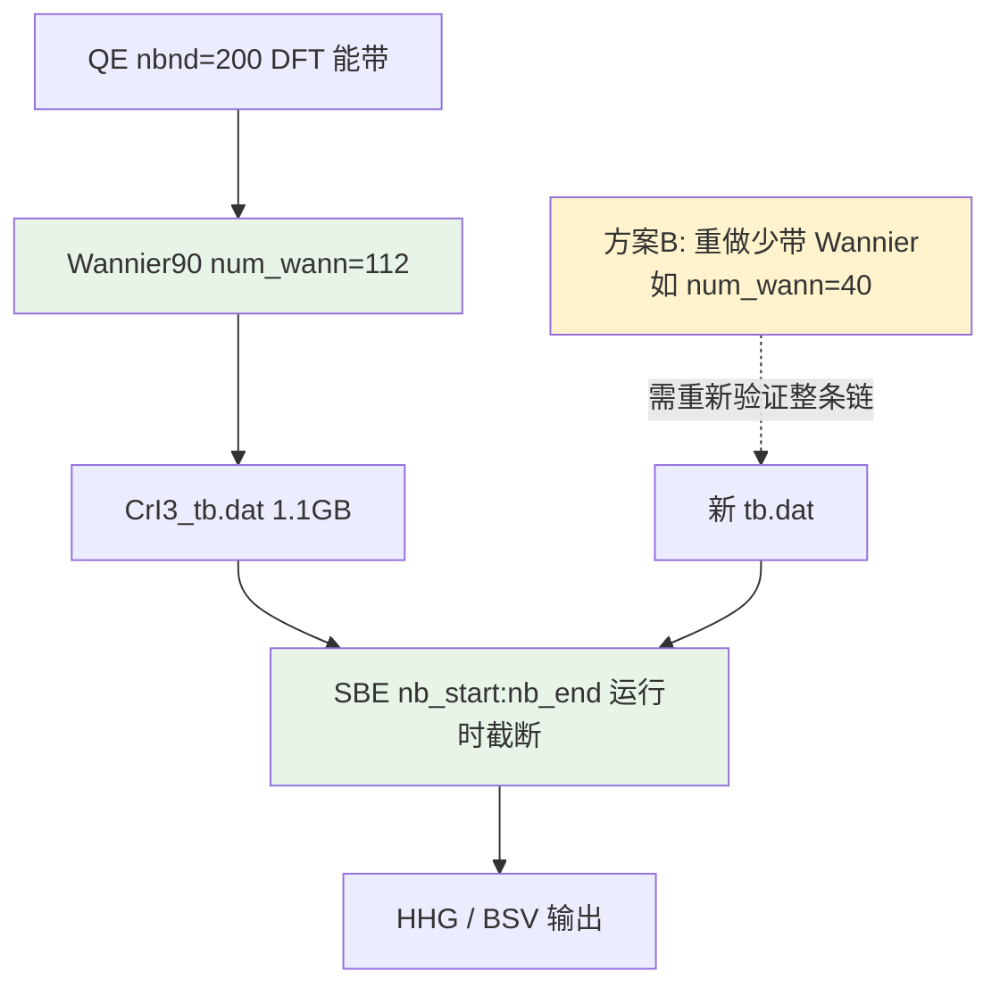

# CrI₃ 双层 AFM：Wannier 带数缩减综合评估方案（2026-07-06）

> **用途**：供场外 AI / 导师判断「是否值得重做少带 Wannier90」或「仅做 SBE 层截断是否足够」。  
> **结论先行**：**不建议现在重做 Wannier90 少带模型**；优先沿用已验证的 **112-band 母模型 + SBE 层 `nb1-104` 经济配置**。仅在需要 **数量级** 加速且接受 **重新验证全链条** 时，才启动 Wannier 缩减路线。

---

## 0. 问题陈述

| 维度 | 现状 |
|------|------|
| 体系 | 双层 CrI₃ HT-AFM，含 SOC，复现 PRB 99, 144401 (2019) Fig.6(d) |
| Wannier90 | `num_wann = 112`（4×Cr d₅/₂ + 12×I p₃/₂，spinor） |
| QE | `nbnd = 200`，`dis_win = [-6, 8] eV`，已收敛且能带插值与 DFT 吻合 |
| SBE 瓶颈 | 密度矩阵演化 ~ O(N²)；BSV 求积需 16 次经典 run |
| 用户诉求 | 缩减 Wannier 带数以加速 HHG / 量子光 BSV 计算 |
| PPT/文献约束 | 汇报强调 **112 带 d+p 母模型**；文献（如 Liu 2022 类工作）主张完整能带 / 深价带对 Berry 与耦合的贡献需审慎处理 |

---

## 1. 已有工作记录（不必再翻找）

### 1.1 第一性原理链（2026-05 工作汇报，已归档）

| 文件 | 位置 |
|------|------|
| QE + Wannier 初版汇报 | `docs/08_QE与Wannier/CrI3_QE_Wannier工作汇报_202605.md` |
| Wannier 输入与输出 | `量子光研究/01_输入与模型/wannier/`（`CrI3.win`、`CrI3_tb.dat` 1.1 GB） |
| ±N TB | `01_输入与模型/CrI3_TB-N/`、`CrI3_TB_mN_Pconj/` |
| QE 输入副本 | `CrI3_TB-N/inputs/CrI3_nscf_soc_mN.in` 等 |

**工作汇报要点**（2026-05）：

- vc-relax → scf(SOC) → nscf(24×24×1, 576 k, nbnd=200) → Wannier90 成功
- 112 WF：Ω_D ≈ 0，disentanglement 收敛，能带插值与 DFT 一致
- 早期 SBE 测试（Houston 规范，10×10）已见奇次谐波
- **计划**中提到 SBE 截断至 ~12 带（75–94）可提速 ~500×——**该估时针对对称低能窗，已被后续验证否定为生产方案**

**工作汇报已过时之处**（2026-05 → 2026-07 进展）：

| 2026-05 叙述 | 2026-07 实际 |
|--------------|--------------|
| `mod_wannier` tb.dat 解析 bug | 已修复；当前 Git 求解器可正确读 112 带 |
| 速度规范为主 | **生产规范为 `lg_cov` 长度规范**；Peierls VG 对称截断已判废 |
| 计划 MC 采样 BSV | **16 节点确定性求积已完成**（~12 h / 3 节点，`nb1-104`） |
| 带截断 75–94 作首选 | 已改为 **全价带 + 截高导带**（`nb1-104`） |

### 1.2 SBE 带窗验证（2026-05–07，权威）

| 文档 | 核心结论 |
|------|----------|
| `docs/03_经典光_收敛测试归档/Wannier模型与截断决策总结_20260518.md` | 112-band 是化学完备母模型；**重做少带 Wannier 是后备，非首选** |
| `docs/03_经典光_收敛测试归档/经典测试补充答复_20260701.md` | **`lg_cov` + `nb1-104` + k40**：H1–H9 与 full112 偏差 <3%；选择定则 leakage 几乎不变 |
| `docs/04_BSV量子光/BSV确定性求积方案_20260612.md` | 生产 BSV 已用 **`nb1-104`**，16 节点 ~12 h |
| `docs/02_求解器_理论与验证/服务器执行清单与BSV估时_20260608.md` | 量子几何/PT 验证 **必须 full112**；BSV 生产可用 nb1-104 |

### 1.3 带编号约定（全文统一）

```text
QE 全空间：VBM = 140, CBM = 141（140 电子，spinor）
Wannier 112 空间：VBM = 84, CBM = 85（去掉 56 条深能带）
full112  = 84 价带 + 28 导带
nb1-104  = 84 价带 + 20 导带（删 bands 105–112，能量 +2.89 ~ +3.22 eV）
对称 20 带窗 75–94 = 10 价 + 10 导（会砍掉 74 条深价带——不可用）
```

---

## 2. 两个不同层级的「缩减」——必须先分清



| 层级 | 操作 | 状态 | 典型加速 | 物理风险 |
|------|------|------|----------|----------|
| **A. SBE 运行时截断** | 同一 `CrI3_tb.dat`，改 `nb_start/nb_end` | ✅ 已大量验证 | `nb1-104` vs full112：**~14%**（N² 缩放） | 低（H1–H11 已对照） |
| **B. 重做 Wannier90** | 改 `num_wann`、投影轨道、能量窗 | ❌ 未做 | 若 N=40：**~8×** vs 112；若 N=20：**~31×** | **高**——新有效模型，HHG 不保证 |
| **C. 有效低能模型** | 从 112-WF 折叠/拟合 4–8 带（Tier2 路线） | 🔄 试探中 | 理论最大，但 4 带玩具已判废 | 中–高，需重新对标 |

**关键澄清**：2026-05 汇报里的「500×」来自 **20 带对称窗（75–94）**，在 `lg_cov` 下 **不能** 作为生产配置；它砍掉了 74 条深价带，破坏占据态完备性，Peierls 下 H1 可放大 **10³–10⁶** 倍。

---

## 3. 方案矩阵（供场外 AI 逐项打分）

### 方案 0（推荐）：保持 112 Wannier + SBE `nb1-104` 生产

| 项 | 内容 |
|----|------|
| 操作 | **不改** QE/Wannier；BSV / 经典生产用 `nb_start=1, nb_end=104` |
| 加速 | 相对 full112：矩阵维度 104²/112² ≈ **86%** → 单次 run 节省 **~14%**；16 节点 BSV **~12 h → ~10 h** |
| 已验证 | H1–H9 <3%；H10–H12 弱信号区可接受；±N 选择定则 leakage 与 full112 一致 |
| 劣势 | H13+ 与 full112 偏离大（但 full112 本身亦近数值地板）；**不能** 宣称高阶 cutoff 完全收敛 |
| 文献/PPT | 仍可说「基于 112 带 d+p **第一性原理** Wannier 母模型」；生产算例用 validated 104-band active space |
| **建议** | **R1 论文与 BSV 生产默认此方案** |

### 方案 1：保持 112 Wannier + SBE full112 基准

| 项 | 内容 |
|----|------|
| 操作 | 所有「绝对谱」「量子几何」「PT 验证」用 `nb1-112` |
| 加速 | 无 |
| 优势 | 与 PPT「完整能带模型」表述完全一致；高阶 / 几何验证最稳 |
| 劣势 | BSV 最慢；112 带在 **velocity gauge** 下有已知规约问题（故生产已弃 VG） |
| **建议** | 保留为 **对照组**，不必所有 BSV 节点都跑 full112 |

### 方案 2：Wannier 缩减为 **Cr-d only（40 spinor WF）**

| 项 | 内容 |
|----|------|
| 操作 | `num_wann=40`；投影仅 `Cr: d`；**需重跑** pw2wan + wannier90 + 能带对比 + 全 SBE 验证 |
| 加速 | SBE：**(40/104)² ≈ 15%** vs nb1-104，**~8×** vs full112；tb.dat 体积显著减小 |
| 优势 | 化学上抓住磁序核心（Cr 3d）；计算最便宜的一档「重做 Wannier」 |
| 劣势 | **丢失 I-p 杂化**；84 条价带压缩到更少 WF 后 **占据数 / 带序 / 带隙** 可能重构；偶次谐波 inter/intra 机制可能变；**无法** 与现有 112 带数值直接对比索引 |
| 风险等级 | 🔴 高——相当于新物理模型 |
| **建议** | 仅当方案 0 仍太慢 **且** 论文只关心 H1–H7 时考虑；必须 full112 对照 |

### 方案 3：Wannier **Cr-d + 部分 I-p**（如 60–80 WF）

| 项 | 内容 |
|----|------|
| 操作 | 例如每层 I 只保留 p_z，或缩小 dis_win；需重新调试 disentanglement |
| 加速 | 介于方案 0 与 2 之间 |
| 优势 | 比 40 带更可能保留卤素中介通道 |
| 劣势 | 窗口内带数 vs num_wann 约束需重新迭代（你已从 nbnd=160→200 踩过坑） |
| **建议** | 方案 2 的折中，但 **调试成本高**，收益不如方案 0 明确 |

### 方案 4：不改 num_wann，**缩小 QE nbnd / dis_win**（不推荐）

| 项 | 内容 |
|----|------|
| 操作 | 减少 nscf 能带或收窄 dis_win 使 Wannier 自然少带 |
| 劣势 | 极易再现「窗口内带数 < num_wann」不收敛；破坏已与 PRB 2019 对齐的参考 |
| **建议** | ❌ 不作为主线 |

### 方案 5：**112-WF → 低能有效哈密顿量**（理论路线，非 Wannier90 重做）

| 项 | 内容 |
|----|------|
| 操作 | 在 **112 带 tb.dat** 上作 Löwdin / folded 4–8 带有效模型（Tier2 / R2 方向） |
| 优势 | 保留第一性原理母模型；可服务 R2 非经典性编码 |
| 劣势 | 4 带玩具引擎已判废；需新 fold 方案 |
| **建议** | 服务 **R2/R3**，不替代 R1 经典 HHG 生产 |

---

## 4. 成本估算（帮助判断「值不值得」）

假设单次经典 run 墙钟 ∝ N_band² × N_k² × N_cycle：

| 配置 | N_band | 相对 full112 单次 | 16 节点 BSV（3 节点并行） |
|------|--------|-------------------|---------------------------|
| full112, k40 | 112 | 1.00× | **~12 h**（已测 ~1.9 h/run） |
| nb1-104, k40 | 104 | **0.86×** | **~10 h** |
| nb30-112, k40 | 83 | 0.55× | ~6.5 h（H9+ 不稳定，❌） |
| 对称 20 带, k40 | 20 | 0.032× | ~0.4 h（物理错误，❌） |
| 重做 40 Wannier | 40 | 0.13× | ~1.5 h（**未验证**，⚠️） |

**结论**：

- 若目标是「BSV 从 12 h 降到 10 h」→ **方案 0 已足够**，不值得承担 Wannier 重做风险。
- 若目标是「BSV 降到 ~1–2 h」→ 必须 **N≲40** 且接受 **新模型 + 全验证**（方案 2），或改 k 网格 / 并行度，而非微调 Wannier。
- 量子光 BSV 的 16 次积分 **已比 MC 便宜 >100×**；当前瓶颈是 **单次经典 SBE 太慢**，不是 Wannier 文件太大。

---

## 5. 与汇报 PPT / 文献立场的对齐

| 来源 | 立场 | 本方案如何处理 |
|------|------|----------------|
| PPT §3 | 完整价带 + 经济导带截断（nb1-104）已验证 | 方案 0 **直接对齐** |
| PPT §5 / Liu 2022 | 偶次谐波由 **带间** 通道主导，非 Berry 假象 | 深价带保留在 nb1-104；**不能** 用对称低能窗 |
| PPT / 理论 v3 | 112 带 d+p 是「自然完备母模型」 | 论文方法节写 112 WF **构造**；数值节写 validated active space |
| Thümmler 2025 | Wannier 规范 + 退相干稳定性 | 已选 `lg_cov`；少带模型需重新检验 |
| 2026-05 汇报 | 「完整能带」印象 | 通过 **显式区分**「母模型 112」与「生产 active 104」化解 |

**可写入论文的诚实表述模板**：

> We construct a 112-band spinor Wannier model including Cr-d and I-p orbitals (…). SBE propagation uses a validated active window of 84 valence + 20 conduction bands (bands 1–104), which reproduces the full 112-band spectrum within 3% for H1–H9 under lg_cov gauge (see Supplementary …). High-order harmonics (H13+) are not claimed converged.

---

## 6. 推荐决策树

```text
你的科学目标是什么？
│
├─ R1：BSV 增强 + 选择定则 + 经典验证（当前主线）
│   └─► 【执行方案 0】112 Wannier + nb1-104 生产 + full112 抽查对照
│
├─ 必须发表「全 112 带传播」说法
│   └─► 【方案 1】仅基准算例用 full112；明确不使用 Peierls VG
│
├─ 服务器时间仍不够（例如需 <2 h  turnaround）
│   ├─ 先优化：k 网格敏感性 / 并行节点 / dt 收敛 / 是否可减少 ncyc
│   └─ 仍不够 → 【方案 2】40 带 Cr-d Wannier 试点 + 强制 full112 对照
│
└─ R2 非经典性 / 低能有效理论
    └─► 【方案 5】112-WF 折叠，不删 Wannier 第一性原理链
```

---

## 7. 若场外 AI 批准「方案 2」时的最小验证清单

1. **Wannier 质量**：|Ω_D|、最大 spread、能带插值 vs QE（Γ–K 路径）
2. **占据数**：新模型价带数是否仍对应 140 电子？带隙是否仍 ~0.65 eV？
3. **经典 HHG**：`lg_cov` / k40 / T2=0.5 / 同激光参数；对比 full112 的 H1–H9、H11
4. **选择定则**：P 共轭 ±N 是否仍满足 N-odd H2？
5. **BSV**：至少 4 节点求积试点 vs 16 节点 full112 参考
6. **轨道特征**：`projwfc` 或 Wannier 投影，解释被删通道

**预估工作量**：QE 不必重跑（若 nscf 仍在）；Wannier + SBE 验证 **~1–2 周** 人工/机时。

---

## 8. 待用户 / 场外 AI 回答的问题

1. **科学截断**：R1 论文核心谐波是 **H1–H9** 还是必须展示 **H11–H15**？BSV「p! 标尺」是否依赖 H13+？
2. **计算预算**：单次 BSV 生产 **~10–12 h / 3 节点** 是否可接受？目标墙钟是多少？
3. **服务器资产**：完整 QE nscf 输出（`CrI3.save` 等）是否仍在服务器？能否 **不重跑 DFT** 只重跑 pw2wan+wannier90？
4. **±N 需求**：少带模型是否也要做 P 共轭 -N？还是仅 +N 生产？
5. **发表叙事**：审稿时能否接受「112 带构造 + 104 带 active space」？还是必须坚持全文 full112？
6. **轨道分析意愿**：是否愿意花 **~0.5 天** 做 `projwfc` / band-character，量化 bands 105–112 成分？
7. **与 Liu 2022 / PRB 2019 对标**：对比论文时，用 full112 还是 nb1-104？

---

## 9. 综合建议（给场外 AI 的一句话版本）

> **不值得为节省 ~14% 时间去重做 Wannier90。** 项目已在 112-band 母模型上完成 `lg_cov`/`nb1-104`/BSV 求积/选择定则闭环；这与 PPT「完整价带 + 经济导带」一致。仅当用户要求 **>5× 总加速** 且接受 **重新验证** 时，才启动 **40 带 Cr-d** 试点；否则继续方案 0，把机时投入 R1 成文与 R2 编码。

---

## 10. 相关文件索引

| 类型 | 路径 |
|------|------|
| 本方案 | `docs/08_QE与Wannier/CrI3_带数缩减评估方案_20260706.md` |
| 2026-05 工作汇报 | `docs/08_QE与Wannier/CrI3_QE_Wannier工作汇报_202605.md` |
| Wannier 输入 | `量子光研究/01_输入与模型/wannier/CrI3.win` |
| tb.dat | `量子光研究/01_输入与模型/wannier/CrI3_tb.dat` |
| 截断决策 | `docs/03_经典光_收敛测试归档/Wannier模型与截断决策总结_20260518.md` |
| 最新收敛答复 | `docs/03_经典光_收敛测试归档/经典测试补充答复_20260701.md` |
| BSV 生产 | `docs/04_BSV量子光/BSV确定性求积方案_20260612.md` |
